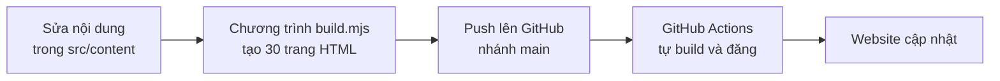
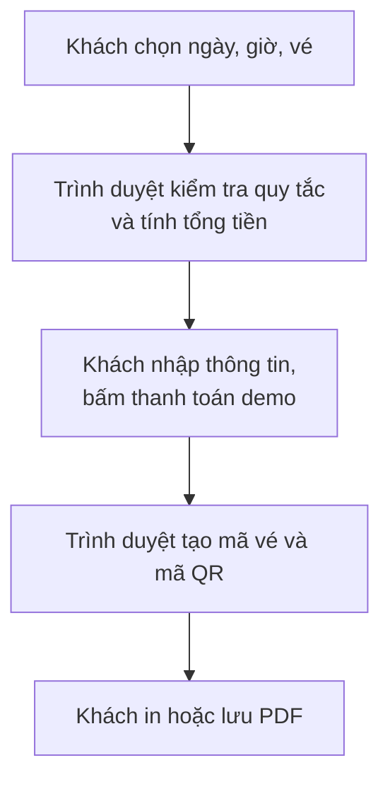

# Hofglück Zittau

Website giới thiệu **Hofglück Zittau**, một trang trại trải nghiệm (Erlebnisbauernhof) ở Zittau, bang Sachsen, Đức. Khách có thể xem hoạt động, đặt vé online, đăng ký thùng rau định kỳ (Hof-Abo), tìm hiểu nông sản và làm quen với các loài vật.

- **Xem trực tiếp:** https://hofglueckzittau.github.io/
- **Ngôn ngữ:** tiếng Đức (mặc định), tiếng Anh, tiếng Việt
- **Thiết bị:** dùng được trên điện thoại, máy tính bảng và máy tính

> **Lưu ý khi thuyết trình:** đây là **bản demo**. Thanh toán, email vé và đăng ký Abo chỉ là mô phỏng, không có tiền hay dữ liệu nào được gửi đi. Xem chi tiết ở [Những gì chưa phải thật](#những-gì-chưa-phải-thật).

## Các trang và chức năng

### Thành phần có trên mọi trang

- **Thanh thông báo demo** ở trên cùng: cho khách biết thanh toán là mô phỏng, ảnh và giá có dấu `*` là tạm thời.
- **Menu và logo:** dẫn tới các trang chính. Trên điện thoại, menu thu vào nút ☰.
- **Nút DE / EN / VI:** đổi ngôn ngữ mà vẫn ở nguyên trang đang xem.
- **Chân trang:** địa chỉ, giờ mở cửa, điện thoại, email, Instagram `@hofglueck_zittau` và các trang pháp lý.

### Trang chủ

Giới thiệu nhanh và dẫn khách tới các trang khác:

- **Ảnh lớn đầu trang:** khẩu hiệu, giờ mở cửa, nút đặt vé và nút xem Abo.
- **Số liệu nổi bật:** rau từ ruộng nhà, 9 loài vật, 7 hoạt động, đổi thùng 1:1.
- **Ba thẻ gợi ý:** tham quan, cho thú ăn, Hof-Kiosk.
- **Giới thiệu Hof-Abo.**
- **"Đang vào mùa":** tự đổi theo tháng hiện tại, nên chủ trang trại không phải sửa tay khi sang mùa.
- **Dải ảnh các loài vật:** bấm vào một con sẽ tới đúng thẻ của con đó.
- **Giới thiệu Hof-Kiosk.**

### Giới thiệu (Über uns)

Câu chuyện hình thành trang trại, tầm nhìn và ba sứ mệnh của dự án.

### Trải nghiệm & đặt vé (Erlebnisse)

Trang quan trọng nhất của website, gồm danh sách hoạt động và phần đặt vé.

| Hoạt động | Giá | Lịch |
| --- | --- | --- |
| Tham quan trang trại | 8 € người lớn, 5 € trẻ em | Sáng và chiều |
| Cho thú ăn | 3 € một suất thức ăn | Sáng và chiều |
| Chụp ảnh cùng thú | Miễn phí, không giới hạn thời gian, không cần đặt | Trong giờ mở cửa |
| Nhặt trứng | 4 €* một người | Chỉ buổi sáng |
| Tự tay hái rau củ | 6 €* một người | Tháng 4 đến tháng 10 |
| Tự làm bơ thủ công | 9 € người lớn, 5 € trẻ em, từ 5 người trở lên | Chỉ buổi chiều |
| Khóa học làm vườn | 8 € người lớn, trẻ em miễn phí | Sáng và chiều |

`*` là giá tạm, chưa được chốt. Ngoài ra còn một thẻ **Hof-Kiosk**, mua hàng không cần vé.

**Các bước đặt vé:**

1. **Chọn ngày và giờ.** Lịch khóa các ngày đã qua và thứ Hai (ngày nghỉ), cho đặt trước tối đa khoảng 6 tháng. Có hai khung giờ: sáng 9:00–12:00 và chiều 13:00–17:00.
2. **Chọn vé.** Hoạt động không phù hợp với ngày giờ đã chọn sẽ bị làm mờ kèm lý do. Tổng tiền cập nhật ngay ở khung bên phải.
3. **Nhập thông tin và chọn cách thanh toán.** Gồm họ tên, email và một trong các cách: PayPal, thẻ, SEPA, Apple Pay / Google Pay (mô phỏng).
4. **Nhận vé điện tử.** Vé có mã QR, mã vé dạng `HG-2026-XXXXXXXX`, ngày giờ và danh sách dịch vụ, có thể in hoặc lưu PDF.

**Các quy tắc website tự kiểm tra:**

- Làm bơ dưới 5 người thì không qua được bước tiếp theo.
- Khóa làm vườn phải có ít nhất một người lớn, vì chỉ có trẻ em thì tổng tiền là 0 €.
- Nếu đổi ngày giờ khiến một vé không còn phù hợp, vé đó tự bị bỏ và khách được báo.
- Mỗi loại vé tối đa 20 người.
- Bấm "Đặt vé" trên thẻ hoạt động sẽ tự chọn sẵn hoạt động đó trong phần đặt vé.

### Hof-Abo & Kiosk

**Hof-Abo** là thùng rau theo mùa, khách đăng ký rồi tự đến trang trại lấy. Khách chọn:

| Lựa chọn | Các phương án |
| --- | --- |
| Kích cỡ | M (1–2 người): 14,90 €* + cọc 3 €. L (3–5 người): 24,90 €* + cọc 5 € |
| Tần suất | Hằng tuần hoặc hằng tháng |
| Ngày lấy | Thứ Sáu hoặc thứ Bảy |

Bảng tóm tắt tự tính lần trả đầu tiên (giá thùng + tiền cọc) và số tiền những lần sau.

**Hệ thống cọc thùng (Pfand)** giống đặt cọc chai ở siêu thị Đức, nhằm giảm rác bao bì. Trang này giải thích 5 tình huống:

| Tình huống | Kết quả |
| --- | --- |
| Mang thùng sạch, nguyên vẹn | Đổi miễn phí lấy thùng đầy rau |
| Quên mang thùng | Đóng thêm cọc, lần sau trả đủ hai thùng thì nhận lại |
| Thùng bị hỏng | Mất cọc, đóng cọc mới |
| Hủy Abo, thùng nguyên vẹn | Hoàn 100% tiền cọc |
| Hủy Abo, thùng hỏng hoặc mất | Không hoàn cọc |

**Hof-Kiosk** là quầy bán hàng ngay tại trang trại, mở cùng giờ với trang trại và không cần vé. Quầy bán trứng, bơ, rau, nước táo, đồ ăn nhẹ và nước uống, trả bằng tiền mặt hoặc không tiếp xúc.

### Nông sản & công thức (Hofprodukte)

- Có **12 loại nông sản** chia theo 4 mùa, gồm cả giống hiếm trong siêu thị và rau Việt Nam như tía tô, rau muống.
- **Nút lọc:** theo mùa, "Hiếm trong siêu thị" hoặc "Rau Việt Nam".
- **Bấm vào một loại** để mở khung chi tiết: đặc điểm, dinh dưỡng, cách bảo quản và công thức nấu ăn.

Phần dinh dưỡng chỉ nói về thành phần, không hứa hẹn chữa bệnh, vì quy định EU 1924/2006 hạn chế các tuyên bố về sức khỏe.

### Động vật (Unsere Tiere)

Có **9 loài**: gà lụa, cừu Ouessant, thỏ lùn, dê lùn châu Phi, cừu mũi đen, chuột lang, alpaca, bò Dexter và vịt chạy. Mỗi thẻ nêu đặc điểm, khách có thể làm gì, vai trò trong trang trại và quy tắc khi tiếp xúc.

Website nhắc khách hạn chế vuốt ve để bảo vệ cả khách lẫn vật nuôi.

### Liên hệ (Kontakt)

Địa chỉ, tọa độ GPS, Plus Code, giờ mở cửa (thứ Ba đến Chủ nhật, 9:00–17:00), điện thoại, email và Instagram.

Bản đồ Google **chỉ tải khi khách bấm nút**, để không gửi dữ liệu của khách cho Google khi chưa được đồng ý. Đây là điểm cần chú ý theo luật bảo vệ dữ liệu châu Âu (GDPR/DSGVO).

### Trang pháp lý

- **Impressum** và **Datenschutz:** thông tin pháp lý bắt buộc với website ở Đức. Hiện chỉ là bản mẫu.
- **Bildnachweis:** nguồn và giấy phép của từng ảnh.

## Website hoạt động thế nào

### Cách hiểu đơn giản

Hãy hình dung website như **một cuốn catalogue được in sẵn**. Mọi trang được tạo trước, rồi đưa lên mạng. Khi khách mở trang, máy chủ chỉ gửi trang có sẵn đó, không có cơ sở dữ liệu hay hệ thống xử lý phía sau. Đây gọi là **website tĩnh**.

Các phần tương tác như lịch đặt vé, tính tiền, tạo mã QR hay lọc nông sản đều chạy **ngay trên trình duyệt của khách**.

**Ưu điểm:**

- Tải nhanh và không có máy chủ riêng phải vận hành.
- Hosting trên GitHub Pages miễn phí.
- Không dùng cookie, không theo dõi khách, phông chữ cũng tự lưu trên website.

**Hạn chế:** không có máy chủ thì website không thể tự nhận tiền, gửi email hay lưu danh sách đặt vé. Đó là lý do các phần này còn là mô phỏng.

### Từ nội dung đến website



1. Nội dung (giá, hoạt động, loài vật, văn bản ba ngôn ngữ) nằm trong các file riêng, tách khỏi phần giao diện.
2. Chương trình `build.mjs` ghép nội dung vào khuôn mẫu, tạo ra 10 loại trang × 3 ngôn ngữ = **30 trang**.
3. Khi code được đẩy lên nhánh `main`, GitHub tự build và đăng lại website.

Nhờ vậy, đổi giá chỉ cần sửa **một chỗ** là mọi trang và cả phần đặt vé đều cập nhật theo, ở cả ba ngôn ngữ.

### Luồng đặt vé



Toàn bộ luồng này diễn ra trong trình duyệt. Vé không được lưu ở đâu cả, nên **tải lại trang là mất vé** nếu chưa in hoặc lưu PDF.

### Google tìm thấy website bằng cách nào

Mỗi trang có tiêu đề và mô tả riêng theo từng ngôn ngữ, báo cho Google biết các bản dịch tương ứng (`hreflang`). Website cũng có sơ đồ trang (`sitemap.xml`) và dữ liệu có cấu trúc (địa chỉ, giờ mở cửa, tọa độ, Instagram) để Google hiểu đây là một địa điểm kinh doanh ở Zittau.

## Những gì chưa phải thật

**Chức năng đang mô phỏng:**

| Chức năng | Hiện tại | Cần gì để chạy thật |
| --- | --- | --- |
| Thanh toán | Không có giao dịch nào | Nhà cung cấp thanh toán và máy chủ |
| Email gửi vé | Không gửi | Dịch vụ email và máy chủ |
| Mã QR | Tạo được nhưng cổng chưa có gì để kiểm tra, và mã chưa được ký nên có thể làm giả | Máy chủ lưu vé và ứng dụng quét vé |
| Số chỗ mỗi khung giờ | Không giới hạn, có thể đặt quá số chỗ | Máy chủ theo dõi số vé đã bán |
| Đăng ký Abo | Chỉ hiện mã xác nhận mẫu | Máy chủ và nơi lưu khách hàng |

**Nội dung còn tạm, cần thay trước khi ra mắt:**

- Số điện thoại `+49 123408899` (số mẫu).
- Ảnh (ảnh mẫu từ Wikimedia Commons, chưa phải ảnh thật của trang trại).
- Giá có dấu `*` (nhặt trứng, hái rau, hai cỡ thùng Abo).
- Giờ mở cửa (chưa được xác nhận).
- Tên chủ trang trại, Impressum và Datenschutz (cần điền đủ và nhờ người có chuyên môn pháp lý kiểm tra).

## Gợi ý trình diễn (khoảng 5 phút)

1. **Trang chủ:** giới thiệu dự án, chỉ phần "Đang vào mùa" tự đổi theo tháng.
2. **Đổi sang tiếng Đức hoặc tiếng Anh** để cho thấy website vẫn ở nguyên trang.
3. **Trải nghiệm:** đặt vé từ đầu đến cuối và cho xem mã QR. Thử đặt làm bơ 4 người để thấy website chặn lại.
4. **Hof-Abo:** đổi cỡ thùng M sang L để thấy tiền tự tính lại, rồi giải thích hệ thống cọc.
5. **Nông sản:** lọc "Rau Việt Nam" và mở một công thức.
6. **Thu nhỏ cửa sổ hoặc mở trên điện thoại** để cho thấy giao diện tự co giãn.
7. **Kết thúc** bằng phần còn mô phỏng và các bước tiếp theo.

## Dành cho người sửa code

Cần Node 18 trở lên, không có thư viện phụ thuộc nào phải cài.

```
npm start         # build rồi xem thử tại http://localhost:4173
npm run build     # tạo website vào thư mục dist/
```

Push lên nhánh `main` thì GitHub Actions (`.github/workflows/deploy.yml`) sẽ tự đăng website. Nếu đổi tên miền, hãy sửa `site.url` trong `src/content/site.mjs`, vì link canonical, hreflang và sitemap đều dùng giá trị này.

| Muốn sửa | File |
| --- | --- |
| Địa chỉ, giờ mở cửa, giá, tiền cọc, Instagram | `src/content/site.mjs` |
| Hoạt động | `src/content/activities.mjs` |
| Loài vật | `src/content/animals.mjs` |
| Nông sản và công thức | `src/content/produce.mjs` |
| Chữ trên giao diện, nội dung các trang | `src/content/ui.mjs` |
| Nguồn ảnh | `src/content/image-credits.json` |
| Khuôn trang, Impressum, Datenschutz | `build.mjs` |
| Giao diện và script chạy trên trình duyệt | `src/assets/` |

Giá có `confirmed: false` trong `site.mjs` sẽ hiện kèm dấu `*`. Thư viện tạo mã QR trong `src/assets/js/qrcode.js` là qrcode-generator (giấy phép MIT).
